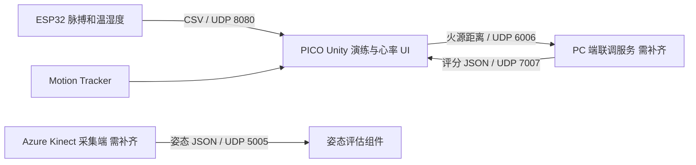

# 火瞳 Huotong XR Fire Safety

基于 Unity、PICO XR 和物联网传感器的沉浸式火灾安全演练原型。将虚拟火焰、烟雾与真实空间叠加，探索环境感知、逃生姿态引导、空间定位和生理反馈的联动体验。

本仓库由原计算机设计大赛作品的四个 Unity 导出包和配套源码整理而成，供黑客松项目展示、代码审阅与后续开发。既有模块与本次仓库整理修复分别记录于 [变更说明](docs/CHANGES.md)。

## 演示与代码入口

- [作品演示视频](media/demo.mp4)（原作品视频，约 68 MiB；可下载播放）
- [火焰与现实场景叠加](modules/mixed-reality-fire/Assets)
- [烟雾暴露与姿态引导](modules/smoke-posture-guidance/Assets)
- [空间追踪、姿态评估与评分 UI](modules/posture-tracking-feedback/Assets/scripts)
- [心率 UDP 接收与显示](modules/posture-tracking-feedback/Assets/UDPReceiver_BPMOnly.cs)
- [ESP32 温湿度及脉搏采集固件](firmware/esp32_biofeedback)
- [虚拟演示资源](modules/virtual-fire-demo/Assets)

## 已提供的功能代码

| 模块 | 代码范围 |
| --- | --- |
| 火情渲染 | 可燃物、火焰粒子跟随、烟雾、风力影响、音效及 PICO 透视开关 |
| 烟雾与引导 | 烟雾区域、暴露累计、浓度 UI 与姿态引导组件 |
| 空间定位 | PICO Motion Tracker 读取、用户位置、与火源的距离 UDP 发送 |
| 姿态与评分 | Kinect 姿态数据接收、姿态评估、应急状态、PICO 评分接收与 UI |
| 生理反馈 | ESP32 发送 BPM/温度/湿度，Unity 接收心率并可视化 |

Kinect 采集端、PC 端完整评分发送服务和 Fire Eyes Alert 手机应用源码没有包含在本次提供的文件中。心率接收组件当前显示 CSV 第一列，温湿度尚未接入同一组件的 UI。烟雾浓度为场景模拟值。

## 使用方式

**这里提供的是按功能分开的 Unity `Assets` 快照，不是具备完整依赖锁定与项目设置的一键运行工程。** 原交付中未包含 `ProjectSettings`、`Packages/manifest.json` 或 Unity 精确版本。两个模块含 `SampleScene`，追踪评分模块及虚拟演示包未提供项目自身的完整场景。

1. 阅读 [环境、导入及硬件连接说明](docs/SETUP.md)。
2. 在安装好对应依赖的 Unity 工程中，一次导入一个模块的 `Assets` 内容及 `.meta` 文件。**不要把四个模块同时复制进同一个 `Assets`**：它们保留了不同版本的同名类与相同 GUID。
3. 先检查场景引用和 Console，再配置 PICO、局域网地址、UDP 端口与传感器。
4. 无硬件时，可用 [UDP 模拟发送工具](tools/send_biofeedback.py)检验接收链路；模拟数据只用于联调。

```bash
python tools/send_biofeedback.py --host 127.0.0.1 --bpm 78 --temperature 26.5 --humidity 48
```

## 数据流



## 验证情况

心率解析器已用独立 C# 测试验证，覆盖 CSV、旧版单值、区域格式、异常和非有限数。仓库还检查了脚本名称、GUID 元数据、文件大小与敏感配置。详见 [验证记录与现有限制](docs/VALIDATION.md)。尚未完成 Unity 编辑器编译、Android 打包或 PICO/ESP32/Kinect 实机联调。

## 来源与许可

作者：付咏琪、程鑫泽、吴浩毅（沿用原作品署名）。资源来源与整理对应关系见 [来源清单](docs/SOURCES.md)和 [第三方资源说明](THIRD_PARTY_NOTICES.md)。未擅自为原项目或第三方资源追加新的开源许可。
